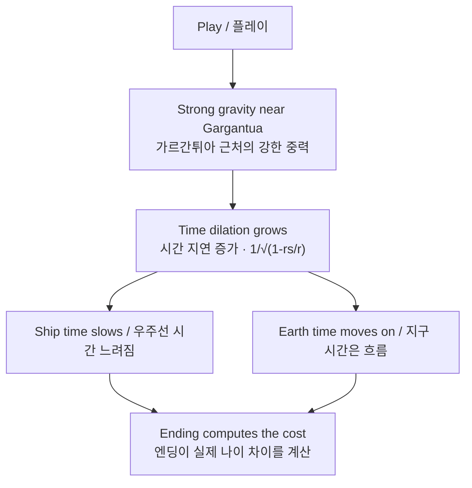

# Gargantua — My Black Hole / 나의 블랙홀

<p align="center">
  
</p>


> **EN**: An interactive, narrated space story that teaches gravitational time dilation to kids — inspired by *Interstellar*. One HTML file, zero build. Open `index.html` and fly.  
> **KO**: *인터스텔라*에서 영감을 받은, 아이들을 위한 인터랙티브 우주 이야기. **중력 시간 지연(gravitational time dilation)**을 직접 날아가며 배웁니다. 빌드 없이 `index.html` 하나만 열면 됩니다.

   




> *"You are still 8.0. Your friend is now 14.3."*  
> *"너는 아직 8.0살. 친구는 이제 14.3살이야."* — numbers come from your own play / 숫자는 실제 플레이 결과에 따라 달라집니다.

---

## Story / 이야기

**EN**  
A signal arrives from another galaxy. You promise your best friend on Earth you'll come back, then fly: Earth → Saturn → through the wormhole → Mann's frozen world → Miller's ocean world → survive Gargantua's pull → orbit the black hole → land on the waves → fly home. The ending computes the real cost of your journey from your own play.

**KO**  
먼 다른 은하에서 신호가 도착합니다. 당신은 지구에 있는 가장 친한 친구에게 “돌아올게”라고 약속하고 출발합니다. 지구 → 토성 → 웜홀 → 만의 얼어붙은 세계 → 밀러의 바다 세계 → 가르간튀아의 중력을 견디며 궤도 비행 → 파도 위 착륙 → 귀환. 엔딩은 플레이를 바탕으로 여행의 실제 시간 비용을 계산합니다.

## Features / 주요 기능

| Area / 구역 | EN | KO |
|---|---|---|
| **3D black hole** | GPU ray-marched gravitational lensing (bent photon geodesics), Doppler-beamed accretion disk, clickable Miller's planet. | GPU 레이마칭(ray-marched) 중력 렌즈 효과, 도플러 강착원반(accretion disk), 클릭 가능한 밀러의 행성. |
| **Journey map** | Pilotable ship (tap/drag/arrow keys), story stops, wormhole jump, warped spacetime fabric, accretion dust, drift trail, point of no return. | 탭/드래그/방향키 조종 우주선, 이야기 정거장, 웜홀 점프, 휘어진 시공간, 궤도 먼지, 이동 경로, 되돌아올 수 없는 지점. |
| **Real physics** | Newton's first law (no space drag; visible retro-burn), inverse-square gravity, slingshots, `1/√(1-rs/r)` with movie-canon Kerr values at Miller's planet. | 뉴턴 제1법칙(공기저항 없음, 역추진 retro-burn), 역제곱 중력, 슬링샷, 밀러 행성 영화 설정값을 반영한 시간 지연 공식. |
| **Robot teacher** | 11-chapter guided story, target beacons, spoken lessons, progress stars, stuck-detection reminders (toggleable). | 11개 챕터 가이드, 목표 비콘, 음성 설명, 진행 별, 막힘 감지 힌트(끄기 가능). |
| **Voice** | Neural TTS narration in-browser (Kokoro-82M via WebGPU/WASM, cached after first load; system-voice fallback) + voice commands. | 브라우저 내 신경망 TTS 내레이션(Kokoro-82M, WebGPU/WASM, 캐시/시스템 음성 대체) + 음성 명령. |
| **Sonified telemetry** | Thrust rumble, speed wind, gravity danger drone, time-warp glide tone. | 추력 럼블, 속도 바람, 중력 위험 드론, 시간 왜곡 글라이드 톤. |
| **Dramatic events** | Confetti/shockwave/shake/fanfare on milestones; falling in triggers slow motion. | 마일스톤마다 색종이/충격파/흔들림/팡파르; 블랙홀 진입 시 슬로모션. |
| **Kid-friendly UI** | Magnetic targets, hover assist, click ripples, big cursor, self-reading/self-closing cards; the story can finish with zero button presses. | 자석형 타겟, 호버 보조, 클릭 물결, 큰 커서, 자동 읽기/닫기 카드; 버튼 없이 완주 가능. |
| **Scavenger hunt** | Hidden treasures twinkle across the Journey map; discover secrets including a crystal treasure inside Gargantua. | 여정 지도 곳곳의 숨겨진 보물. 가르간튀아 깊은 곳의 크리스탈 보물 등 비밀을 찾을 수 있습니다. (`treasure.html`, 보물 이미지 에셋) |

## Controls / 조작법

| Input / 입력 | Action / 동작 |
|---|---|
| Tap / drag on map | Fly the ship (planets are magnetic) / 우주선 비행(행성 자석 효과) |
| Arrow keys | Manual thrust / turn / retro-burn / 추력·회전·역추진 |
| Drag in 3D view | Look around / 시점 둘러보기 |
| Scroll / zoom buttons | Fly closer or farther / 확대·축소 이동 |
| Click blue planet (3D) | Land on Miller's planet / 밀러의 행성 착륙 |
| Mic button + speech | `"go to Saturn"`, `"orbit"`, `"fly home"`, `"stop"`, `"help"` |

**Settings (top-right) / 설정(오른쪽 위):** Journey/Black hole view, Gravity visuals, Read aloud, Voice control, Sounds, Teacher.  
**3D Quality (bottom-left in 3D) / 3D 품질(3D 화면 왼쪽 아래):** render Quality.

## Quick start / 빠른 시작

```bash
# clone / 클론
git clone https://github.com/anthonycho-ux/gargantua.git
cd gargantua
```

1. **EN:** Double-click `index.html` and start in Journey mode.  
   **KO:** `index.html`을 더블클릭하고 Journey(여정) 모드에서 시작하세요.
2. No install, no bundler, no server required for the core experience. / 설치·번들러·서버 없이 핵심 경험 실행 가능.
3. Neural voice needs internet once to download the model, then it's cached; falls back to system voice. / 신경망 음성은 최초 1회 모델 다운로드(이후 캐시), 필요 시 시스템 음성으로 대체.

## Tech notes / 기술 노트

- One file, no runtime dependencies: `index.html` (+ assets/backups in repo). / 단일 파일 중심, 런타임 의존성 없음.
- WebGL2 fragment-shader ray marcher (320 steps, adaptive) for the black hole. / 블랙홀용 WebGL2 fragment shader 레이마처.
- 2D canvas for the journey map; Web Audio API for synthesized sound. / 여정 지도 Canvas, 사운드 Web Audio API.
- Progress (story chapter, quality) persists in `localStorage`. / 진행 상태 localStorage 저장.
- `backups/` holds a pre-refactor snapshot. / `backups/`에 리팩터 이전 스냅샷 보관.

---
Made by Anthony & Aside for one very curious 2nd grader. 🚀  
한 명의 아주 호기심 많은 2학년을 위해 Anthony & Aside가 만들었습니다. 🚀
