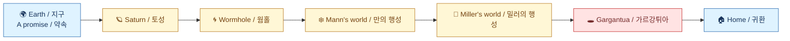

# Gargantua — My Black Hole / 가르강튀아 — 나의 블랙홀

  

> **EN** One night a signal arrives from another galaxy. You promise your best friend on Earth that you will come back, and then you fly.
>
> **KO** 어느 날 밤, 아주 멀리 떨어진 은하에서 신호가 찾아옵니다. 지구에 남은 가장 친한 친구에게 꼭 돌아오겠다고 약속하고, 우주선을 타고 길을 떠납니다.

That promise is the whole story. Everything else — the wormhole, the frozen world, the ocean planet with waves taller than mountains — is the long way home, and the price of the trip is paid in years. By the time you return, the friend you left is older than you are.

이 이야기의 중심에는 바로 그 약속이 있습니다. 웜홀을 지나고, 얼어붙은 별을 거쳐, 산보다 높은 파도가 일렁이는 바다 행성을 지나는 긴 여정은 모두 집으로 돌아가기 위한 과정입니다. 그 여행의 값은 시간으로 치릅니다. 마침내 지구로 돌아왔을 때, 떠나며 남겨둔 친구는 나보다 나이가 많아져 있습니다.

## The flight / 비행

You lift off from Earth with Saturn ahead of you, a pale ringed dot that grows for a long time before it becomes a place. Past it, the wormhole waits: a sphere of bent starlight, quiet as a soap bubble, and on the other side the sky is wrong in a way that takes a moment to notice.

토성을 향해 지구를 떠납니다. 창백한 고리 모양 점은 한참 동안 점점 커지다가, 어느새 하나의 장소가 됩니다. 그 너머에서 웜홀이 기다립니다. 비눗방울처럼 조용하게 휘어진 별빛으로 이루어진 구체이고, 그 건너편에 닿으면 하늘이 뭔가 잘못된 것 같은 느낌이 잠시 뒤에야 따라옵니다.

Mann's world is white and still. Miller's world is blue and does not stop moving — a shallow sea over a planet turning so fast that the horizon keeps sliding. You are told, in the calm voice of the little robot who teaches you, that an hour down there costs years up here. You land anyway. That is the moment the number stops being a number.

만의 행성은 온통 하얗고 고요합니다. 밀러의 행성은 온통 파랗고, 잠시도 멈추지 않습니다. 지평선이 계속 미끄러질 만큼 빠르게 도는 행성 위의 얕은 바다입니다. 곁을 지키는 작은 로봇이 차분한 목소리로 알려줍니다. 저 아래에서의 한 시간이 이 위에서는 몇 년이 된다고. 그래도 내려앉습니다. 그 순간, 숫자는 더 이상 숫자가 아니게 됩니다.

Then Gargantua itself: a black hole with a disk of light turning around it, bright enough to read by and completely silent. You fall toward it, brake with a retro-burn that pushes you back into your seat, swing around the far side, and come out the other way with the ship pointed home.

마침내 가르강튀아가 나옵니다. 빛의 고리를 두른 블랙홀입니다. 책을 읽을 수 있을 만큼 밝은데 소리는 전혀 나지 않습니다. 그쪽으로 떨어지다가, 몸이 좌석에 파묻힐 만큼 역추진으로 속도를 줄이고, 반대편을 크게 돌아 나오면서 우주선의 코를 집 쪽으로 돌립니다.

When you finally land, the ending does the arithmetic for you. It takes the time you actually spent near the hole — how close you flew, how long you lingered — and tells you who you are now and who your friend has become. The first time it says *you are still eight and your friend is fourteen*, it lands harder than any explosion in the game.

마침내 착륙하면 마지막 화면이 계산을 대신 해줍니다. 블랙홀 가까이에서 실제로 보낸 시간, 얼마나 가까이 날았는지, 얼마나 오래 머물렀는지를 가지고, 지금의 나와 그동안의 친구가 누구인지 알려줍니다. 처음으로 "나는 아직 여덟 살인데, 친구는 열네 살이 되었습니다"라는 문장을 마주하면, 게임 속 어떤 폭발 장면보다 오래 마음에 남습니다.

## How you fly / 조종하는 법

You fly with your hands. Tap or drag on the map and the ship turns toward your finger; the arrow keys give you thrust, turn, and a retro-burn for stopping. There is no air in space, so nothing slows you down on its own — if you want to stop, you have to burn the engines backwards, and you can watch the ship do it.

손으로 우주선을 조종합니다. 지도 위를 누르거나 드래그하면 우주선이 손끝이 가리키는 쪽으로 머리를 돌립니다. 화살표 키로는 앞으로 나아가고, 방향을 바꾸고, 역추진으로 멈춥니다. 우주에는 공기가 없으니 저절로 줄어드는 속도도 없습니다. 멈추고 싶다면 엔진을 반대 방향으로 뿜어야 하고, 우주선이 실제로 그렇게 하는 모습을 볼 수 있습니다.

Planets pull. Get close and the ship curves; line it up right and you get a slingshot for free. Somewhere past Miller's world there is a point where turning back costs more fuel than going on, and the map will tell you when you have crossed it.

행성은 우주선을 끌어당깁니다. 가까이 가면 궤도가 휘고, 각도를 잘 맞추면 연료를 들이지 않고 튕겨 나갑니다. 밀러의 행성을 지나 어딘가에는, 되돌아가는 데 드는 연료가 계속 나아가는 것보다 비싸지는 지점이 있습니다. 그 선을 넘으면 지도가 알려줍니다.

A small robot rides with you. It has eleven things to teach, a beacon for each one, and a habit of reading its lessons out loud. If you get stuck it will say something. If you would rather explore in silence, you can turn it off.

작은 로봇이 함께 탑니다. 알려줄 것이 열한 가지 있고, 하나마다 목표 표시가 있으며, 배운 것을 소리 내어 읽어주는 버릇이 있습니다. 막히면 먼저 말을 겁니다. 조용히 혼자 둘러보고 싶다면 로봇은 꺼두면 됩니다.

## Why it feels real / 진짜처럼 느껴지는 이유

The black hole is not a picture. It is a shader tracing light rays as gravity bends them, which is why the disk appears to wrap over the top of the sphere and under the bottom at the same time — that is what lensing does, and the film got it right too.

이 블랙홀은 그림이 아닙니다. 중력이 휘게 만든 빛의 경로를 셰이더가 실시간으로 따라가며 그립니다. 그래서 빛의 고리가 구체의 위쪽과 아래쪽을 동시에 감싸는 것처럼 보입니다. 중력 렌즈가 실제로 그렇게 만들고, 영화도 같은 방식으로 표현했습니다.

The disk is brighter on one side because it is moving toward you, and dimmer on the other because it is moving away. The ship follows Newton's first law. Gravity falls off with the square of distance. And the clocks in the corner run the real formula, so the longer you stay near Gargantua, the further your friend's clock drifts ahead of yours.

빛의 고리는 나에게 다가오는 쪽이 더 밝고, 멀어지는 쪽이 더 어둡습니다. 우주선은 뉴턴의 제1법칙을 그대로 따릅니다. 중력은 거리의 제곱만큼 약해집니다. 화면 구석의 시계는 실제 공식대로 흘러가서, 가르강튀아 근처에 오래 있을수록 친구의 시계는 내 시계보다 더 앞서 갑니다.

## Sound, because space is silent / 소리, 고요한 우주를 채우는 법

Nothing out there makes a noise, so the ship makes its own: a low rumble when the engines push, a rising wind as you pick up speed, a warning drone when gravity gets dangerous, and a single long tone when time starts to bend. It is not decoration. It is the instrument panel, played out loud.

우주에는 소리가 없으니 우주선이 스스로 냅니다. 엔진이 힘을 낼 때 낮게 울리고, 속도가 붙으면 바람 소리가 커지고, 중력이 위험해지면 경고음이 깔리고, 시간이 휘기 시작하면 길고 맑은 소리가 한 번 지나갑니다. 장식이 아닙니다. 계기판을 귀로 듣는 것입니다.

## Running it / 실행하는 법

Download the folder and open `index.html`. That is the whole install. It needs a browser with WebGL2, works offline, and keeps your progress — chapter, quality setting, treasures found — in the browser itself. The neural voice downloads once and then stays cached; without it the page falls back to the voice already on your computer.

폴더를 내려받아 `index.html`을 열면 끝입니다. 설치 과정이 따로 없습니다. WebGL2를 지원하는 브라우저만 있으면 인터넷 없이도 돌아가고, 진행한 단계와 화질 설정, 찾아낸 보물은 브라우저 안에 남습니다. 신경망 음성은 처음 한 번만 내려받아 캐시되고, 그게 없으면 컴퓨터에 이미 있는 목소리로 넘어갑니다.

There is also a scavenger hunt hidden across the journey map. Three treasures twinkle faintly where you would not think to look, and if you fly deep enough into Gargantua there is one more.

여정 지도 곳곳에는 숨은 보물찾기도 있습니다. 생각지도 못한 세 곳에서 보물이 희미하게 반짝이고, 가르강튀아 아주 깊은 곳까지 들어가면 하나가 더 있습니다.

## Under the hood / 속에 들어간 기술

One HTML file, no build step, no dependencies. The black hole is a WebGL2 fragment shader marching photons in 320 adaptive steps. The journey map is a 2D canvas. All sound is synthesized with the Web Audio API. The gem at the bottom of the hole is a real photograph, cut out and embedded as a texture.

HTML 파일 하나로 이루어져 있습니다. 빌드도, 외부 라이브러리도 없습니다. 블랙홀은 WebGL2 프래그먼트 셰이더가 광자를 320단계로 따라가며 그립니다. 여정 지도는 2D 캔버스입니다. 모든 소리는 Web Audio API로 합성합니다. 블랙홀 바닥의 보석은 실제 사진을 오려내어 텍스처로 넣은 것입니다.

---

Made for one very curious second grader, who asked for a black hole and got a physics lesson wearing a story.

블랙홀이 궁금하다고 물었더니 이야기의 옷을 입은 물리 수업을 받게 된, 아주 호기심 많은 초등학교 2학년을 위해 만들었습니다.
